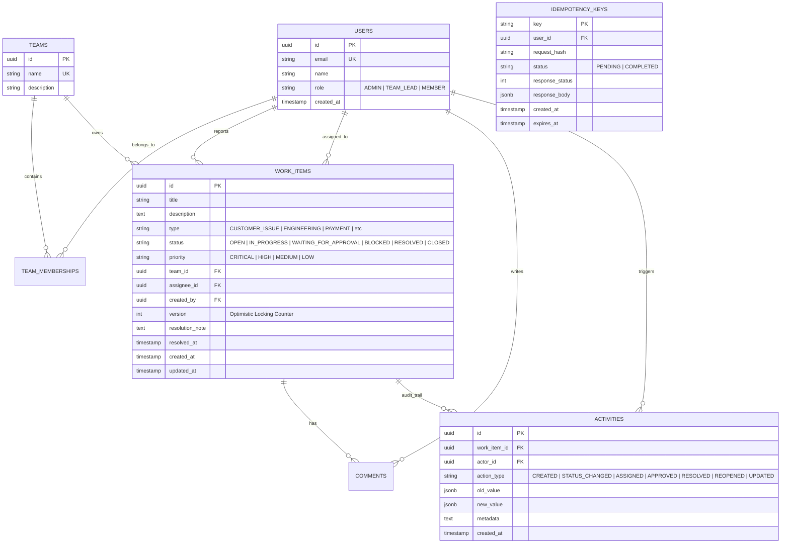
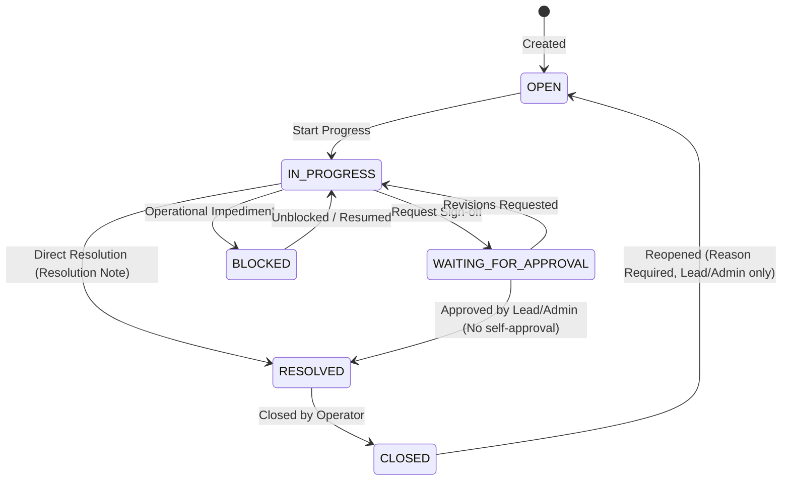
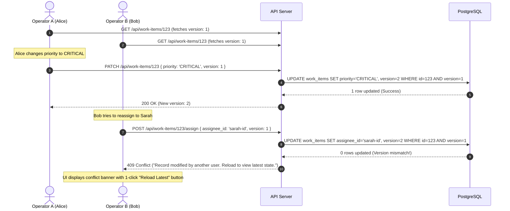
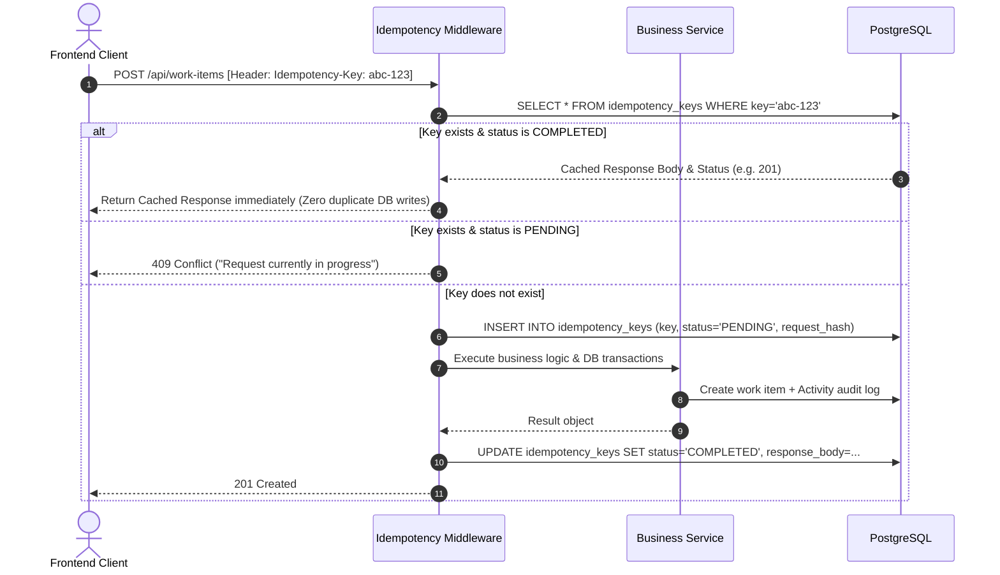

# Newtonite Operations Platform — Architecture & Technical Defense

This document provides the in-depth architectural breakdown, sequence diagrams, and interview defense rationale for the **Newtonite Operations Management System**.

---

## 1. Domain Model & Entity-Relationship Architecture



---

## 2. Finite State Machine (Workflow State Transitions)

The status transitions are enforced by a centralized state machine in `backend/src/work-items/workflow.ts`. No status change can bypass this engine.



---

## 3. Concurrency Control: Optimistic Locking Deep Dive

### The Hazard
In high-stress operations (such as payment outage triage), multiple operators frequently open the same incident ticket.
If Operator A changes priority to `CRITICAL` while Operator B simultaneously reassigns the ticket to another team, a naive `UPDATE work_items SET ... WHERE id = :id` will cause whichever write arrives last to silently overwrite the earlier write (the "Lost Update" anomaly).

### The Solution: Versioned Optimistic Updates
Each `work_items` record carries an integer `version` field starting at `1`.



---

## 4. Idempotency Key Lifecycle

To prevent duplicate incident ticket creation and duplicate status transitions caused by client retries or network hiccups:



---

## 5. Role-Based Access Control (RBAC) Matrix

| Action | Admin | Team Lead | Team Member |
| :--- | :---: | :---: | :---: |
| **View Work Items** | All Teams | Assigned Teams | Assigned Teams |
| **Create Work Item** | Any Team | Assigned Teams | Assigned Teams |
| **Update Work Item Details** | Yes | Yes | Assigned Items / Team Items |
| **Reassign Assignee** | Yes | Yes (Within Team) | No |
| **Submit for Approval** | Yes | Yes | Yes |
| **Approve Item** | Yes (Not self) | Yes (Not self) | No |
| **Resolve Item** | Yes | Yes | Assigned Items Only |
| **Close Item** | Yes | Yes | Yes |
| **Reopen Closed Item** | Yes | Yes | No |
| **Post Comments** | Yes | Yes | Yes |

---

## 6. Interview Preparation & Technical Defense Q&A

### Q1: Why did you choose Knex with explicit migrations over an ORM like Prisma or TypeORM?
> **Answer**: In operational management systems, deterministic query control and transparent database transactions are critical. Knex provides full visibility over the SQL generated, avoids hidden N+1 query patterns, and makes atomic multi-table transactions (`db.transaction`) crystal clear. Furthermore, explicit TypeScript migrations give full control over PostgreSQL indexes and constraints without ORM schema drift.

### Q2: How does your system guarantee that audit logs are never missing or drifted from the state?
> **Answer**: Audit logs are written in the exact same ACID transaction as the state mutation. In `work-items.service.ts`:
> ```typescript
> return db.transaction(async (trx) => {
>   const updated = await optimisticUpdate(trx, id, version, updates);
>   await recordActivity(trx, id, userId, actionType, oldValue, newValue);
>   return updated;
> });
> ```
> If the activity insert fails, the state change rolls back. If the state change fails, no activity record is created.

### Q3: How do you prevent self-approval from a security and compliance perspective?
> **Answer**: In `approve()` within `work-items.service.ts`:
> 1. Role verification: Rejects `MEMBER` role users.
> 2. Segregation of duties: Compares `item.created_by === user.id`. If true, throws `ForbiddenError("You cannot approve a work item you created")`.
> This complies with standard SOX / SOC2 operational compliance requirements.
